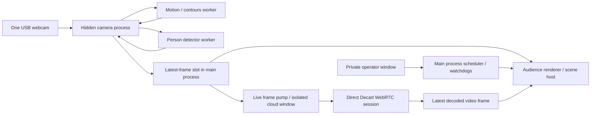

# Architecture

Electron provides a macOS/Linux desktop shell, native output-display enumeration, full-screen windows, permissions, isolated renderer processes, and a separate operator console. Canvas 2D supplies the visuals; bundled MediaPipe/EfficientDet-Lite0 supplies local person detection, and Pose Landmarker Full supplies Afterglow’s per-person masks. Native browser media capture is shared by all scenes. No local HTTP server or open control port is required; a restricted `reverie://app/` protocol serves packaged assets.

## Failure boundaries

The main process owns scheduling using a monotonic clock, settings, windows, log rotation, credentials and the cloud connection lock. Scene deadlines continue when the camera, detector or cloud is unavailable. Independent camera/renderer heartbeats restart lost or unresponsive processes with a 1.5-second delay. Cloud setup and media freshness have main-process deadlines; stopping the service disposes WebRTC resources even if its JavaScript stalls.

Audience placement ignores Dock/menu-bar work-area notifications and applies only changed output geometry. Native full-screen transitions are serialized through their completion events; monitor changes during an animation replace the pending layout. Repeated display notifications and reopening the audience view preserve manual full-screen choices. Hidden output stays hidden until explicitly reopened.

The engine captures at up to 30 fps. Publishing waits for an IPC acknowledgement; the main process holds only the newest frame. The audience has at most one frame request outstanding. Motion and inference each have a single in-flight job, with no accumulated work queue. Detection is sampled every 300/400/650 ms; motion every 65/90/140 ms according to quality. Old analysis is expired at 1.5 seconds; old boxes at 1.6 seconds; the rendered camera at two seconds. Stalled video is reopened after 4.5 seconds. No persistent tracks are maintained.

| Resource | Bound |
|---|---|
| Camera plane | 960×540 / 640×360 / 480×270 locally; 1280×720 during Lucy setup/playback at every quality level. Person detection keeps the local resolution budget. |
| Local motion/edge plane | 384×216 / 256×144 / 160×90 |
| Output canvas | 16:9: 1920×1080 / 1600×900 / 1280×720. 4:3: 1392×1044 / 1200×900 / 960×720. Fixed formats are contained on the display; Fill follows the viewport's physical pixels, capped by the 16:9 quality dimensions. |
| Output mapping | Standard fitting uses the full viewport. The LED-wall preset places a 1392×1044 device-pixel base area, plus a saved 0–200 pixel right-edge extension (default 20), at saved left/top offsets inside the viewport, with black outside; coordinates are divided by devicePixelRatio. Small previews shrink uniformly and offsets clamp in bounds. The 4:3 canvas stretches horizontally to fill the calibrated width. Render quality does not change placement. |
| Bay and garden artwork canvas | Half the output width and height, except Living world at three-quarter dimensions for painted detail; upscaled once beneath the full-resolution portal; the original bay fills the output upright; Living world has a separate misty surround and painted interior, while the garden fits the opening; released when leaving artwork scenes |
| Detection | 24 boxes; COCO person only, score ≥0.34 |
| Motion | 24×14 grid; 48 strongest motion points; 24 occupied still points |
| Small wonderful things · Living world | Reference-traced smaller portal; separate photographic surround and painted interior; three connected reference character cutouts and a separate rock; one shared WebGL context for restrained neck/head, foliage and tail bending; hugging forearm redraw uses the same mesh and UVs over the rock; rigid fallback after context loss; 120 Hz spring substeps and independent behavior scheduling; bounded wave/contact effects; original scene untouched |
| Small wonderful things | Six independently animated sprite characters, six poses each; local horizontal motion response, bounded travel and cooldowns; 120 ms shared gate plus 180–360 ms local hold; grounded anticipation and one eased hop; water-only GPU pass |
| Bubbles | 32 / 24 / 16; maximum lifetime 4.4 seconds; radius 1.3–2.7% of artwork width; immediate burst and up to 14/second at current motion points |
| Bay ripples / splashes | 8 ripples fading within 1.4 seconds; 56 splash droplets fading within 0.65 seconds |
| Garden | 112 / 80 / 48 plants; maximum lifetime 46 seconds; 12 butterflies; cached botanical artwork and foliage |
| Words in motion | 48 local motion points drive a 96 / 80 / 64-column color field (at most 96 rows); two cached output-size canvases keep text crisp; 120 ms attack and 950 ms release; no camera-frame retention |
| Transition | One old render snapshot, 1.4 seconds; no second active scene. Artwork entry uses an opaque scene-colored wash instead of the preceding camera scene. |
| Cloud | One live connection; one input and one output frame; one IPC in flight per direction; no queue |
| Logs | 80 in-memory entries; approximately 2 MiB on disk |

Automatic quality steps down after three one-second samples below 25 fps and steps up after twenty above 28 fps. Lowering quality reduces capture resolution, analysis rate and effect counts along with output resolution. The 30 fps metric counts rendered frames, not guaranteed camera acquisition fps or measured projector scanout. IPC and GC overhead remain platform dependent.

## Coordinate contract

The engine aspect-contains the sensor in a 16:9 camera plane and applies optional mirroring **before** motion and detection. All scenes receive this same plane. The audience renderer center-crops camera pixels and contours to cover the chosen output ratio, and applies that same transform to detection boxes and motion points before camera scenes receive their context. Fully offscreen detections and points are omitted. Artwork scenes keep the original normalized interaction coordinates across their landscape. Normalized x/y are top-left origin, range approximately 0–1; box extents can reach an edge for partially visible people. Drawing maps them through `x*w, y*h`. There is no identity, demographic or physical-depth field.

Artwork scenes request a compact packet containing only `{seq, at, demo, boxes, motion: {points, calm, amount}}`. Camera pixels, edge maps, energy grids and previews stay out of the audience renderer for these scenes. In-flight packets in the wrong format are discarded across camera/artwork transitions; the shared full packet remains available for camera scenes and live scenes.

`FramePacket`: `{seq, at, width, height, pixels, boxes, motion, demo}`. `seq` is per-engine monotonic; `at` is a wall-clock timestamp for age checks. `pixels` is RGBA `Uint8ClampedArray`. `boxes` are `{x,y,w,h,score}`; score is detector confidence, not a calibrated probability. Spatial smoothing matches nearby boxes for one inference update only and discards unmatched old boxes; it does not establish identities. `motion` includes `{points,calm,amount,energy,edges,width,height,cols,rows,at}`. Points contain `{x,y,strength}`. `amount` is normalized smoothed grayscale change after a noise floor and global illumination correction, not percentage of people moving. Grid occupancy is tested against the current person boxes. Stillness needs >2.5 seconds of low local change, accumulates to ten seconds, and decays slowly through brief movement; unoccupied regions decay faster.

## Scene lifecycle and context

`initialize(context)` allocates resources; `activate(context)` starts the scene; `update(context)` advances simulation; `render(canvas2D, context)` draws; `deactivate()` ends activity; `cleanup()` releases resources. All methods must be synchronous, short and idempotent for cleanup. Each activation uses a fresh instance. `SceneHost` catches lifecycle/update/render exceptions, cleans up, quarantines the ID for the renderer lifetime and lets the scheduler continue. A hard infinite loop is recovered by restarting the audience process, not by catching an exception. No scene may own a camera, network session or accumulating request queue.

Context: `{w,h,time,dt,quality,intensity,frame,analysis,robotVideo,demo}`. `time` and `dt` are seconds; `dt` is clamped to 0.1; quality is 0/1/2. `frame` is a shared CanvasImageSource or null. `analysis` has `{boxes,motion}` with empty, safe defaults when unavailable. `robotVideo` is the canvas containing the latest decoded Lucy video frame for the active live scene, if any. Robot and cartoon reuse the same renderer, clipping this video inside the angled portal while retaining the normal camera view and pink-to-blue tint outside. Inputs are read-only by convention. Scene resources and simulations must tolerate changes in w/h and quality without allocating per-frame textures.

The garden and painted bay render their artwork at half the output width and height, using 75% fewer artwork pixels while keeping the border and branding at normal output resolution. Plant counts and animation timing are unchanged. During this scene, `frame(seq, true)` returns `{seq,at,demo,boxes,motion:{points,calm,amount}}`; camera pixels, edges, energy grids and JPEG previews are omitted before IPC serialization, and the audience does not upload camera images. The engine still supplies normal local motion/person analysis and retains its full packet for other scenes and live scenes. Scene changes refetch the correct packet format and discard requests that finish after their format becomes obsolete.

## Security and data lifecycle

Renderers have context isolation, sandboxing and no Node integration. Preloads expose role-specific IPC only; main-process handlers check sender identity. Only the engine can request camera permission, and audio is not requested. Local windows have a self-only network CSP; only the isolated robot window has cloud signaling network permissions. The root key stays in main; a short-lived model-scoped token is minted for each job. Windows cannot navigate to arbitrary content or open new windows. No telemetry or automatic updater is configured.

Audience inputs/results remain in memory; only settings and controlled status text persist. Decart retention and handling are outside the local application's control; enabling the live robot/cartoon feature streams the live camera off-device while the scene connects and plays. PNG test snapshots are generated only by explicit test scripts with synthetic media. The private `.env` is access-restricted but unencrypted. Native permission decisions remain under OS control.

## Live scene availability

The scheduler excludes robots and cartoon until their live video frame is decoded by the audience renderer and acknowledged to main. A connection starts only when its playlist slot is due or the operator selects it; there is no prewarming. Each job carries its scene ID and selects Lucy Latest for robots and `ghibli25`, or Lucy Restyle 2 for `cartoon` through direct Decart; only that scene becomes available. Both effects share the same credentials and single-connection gate. Manual selection requests a connection and waits on the current scene until video arrives. Failed connections clear availability and the latest output; other enabled scenes continue. A live-only unavailable playlist uses neutral ambient output (`active: null`). The operator gets the skip reason, error code, stage and recovery state.

The hidden robot window pulls fresh shared-camera frames at up to 30 fps and paints a model-sized WebRTC input canvas (1280×720 for Lucy 2.5, 1280×704 for Restyle 2). During setup/playback the camera service retains a 1280×720 plane; lower projector quality does not reduce Lucy input detail. Uniform center-cropping trims eight pixels from each vertical edge for Restyle instead of squeezing the camera image. A `requestVideoFrameCallback` on Lucy's returned video publishes decoded 960×540 RGBA frames at up to 24 fps, with one acknowledged IPC in flight. Main retains only the latest frame and stamps its arrival time. Audience pulls it into a separate canvas and renders that current canvas every frame. Old-session IDs and non-increasing frame sequences are rejected. Camera and returned-video freshness expire after two seconds; no timer repaint can impersonate a newly decoded remote frame.

Invalid dimensions and black/flat decoded frames are dropped, including during startup. A transient bad frame no longer terminates an otherwise healthy session. Only usable frames advance the output sequence and freshness timestamp, so the audience can hold the last good frame for less than two seconds and resume on the same connection. Two seconds without usable output ends the live session: the worker reports `INVALID_IMAGE` if it has rejected frames since the last good frame, or `VIDEO_STALLED` if decoded callbacks stopped; the independent main watchdog may also report `VIDEO_STALLED`. Startup still uses the 25-second setup deadline, and frame recovery does not extend the scene's playback limit.

Main enforces 25 seconds for connection setup. Once displayed, the stream is limited to the configured scene duration, including paused time. Reselection does not reset that deadline. Each provider attempt is also bounded by setup plus the configured duration. Lucy remains enabled when the connection ends. Enabled scenes recur without successful-session cooldowns or connection caps. Rotation waits for a pending live scene to finish setup; back-to-back live scenes close the old service before starting the new one. Scene exit, display/camera loss, settings cancellation and app quit first remove the scene, then send a stop message to the isolated service. The service immediately stops media and closes its single-use signaling socket with code 1000. It waits for the socket close event, bounded at four seconds, and reports the close code and whether the handshake was clean. Main retains the connection lock until that result, or forces teardown after five seconds. A clean signaling close still does not confirm that the upstream provider released its concurrency quota. Audience recovery starts without a cached result. Decart credentials are scoped to the selected model and issued for setup with a 120-second expiry. Lucy 2.5 sets `self_anchor=false` at connection time; Restyle 2 does not expose this option. FAL backup is disabled to avoid unverified model or anchoring behavior. Each new provider connection gets a fresh temporary token.

Concurrency rejections before video arrives are classified as `SESSION_BUSY`. After the last configured provider fails, a 60-second backoff prevents tight retry loops. Connections become eligible after the wait, but open only for a later scheduled slot or an explicit selection. Paused rotation does not retry in the background. Lucy stays enabled throughout. No old `cloud-budget.json` cap or cooldown is loaded. App startup always resets Lucy to disabled, independent of saved settings.

## Afterglow: local instance masks

`SegmentationService` runs only while Afterglow is active, using the existing shared camera plane after letterboxing and mirroring. One CPU MediaPipe worker processes at most one capture at a time, with at most sixteen poses; the worker and main-process publication guard share the same capacity constant. Quality sets the analysis resolution and minimum interval; native mask resources are released after each inference callback. The next capture waits for publication acknowledgment, so there is no inference queue. Only newly advanced camera frames are submitted. Initialization/inference stalls time out after 15 seconds and retry after 30 seconds. Exit, reselection, camera changes, mirroring changes, and rehearsal changes terminate the worker and clear all tracks.

Candidate masks need at least four visible body landmarks on their foreground, including two torso joints and two nondegenerate connections. An upper or lower body is sufficient; a face, upright posture and full skeleton are not required. Near-identical masks are suppressed; strongly overlapping masks with distinct joint positions remain separate. Selection prefers stronger landmark evidence without lowering the model's detection/presence thresholds. These checks use the model's own outputs and do not independently prove that an object is human. MediaPipe's [Pose Landmarker reference](https://developers.google.com/edge/mediapipe/solutions/vision/pose_landmarker) describes the pose limit, confidence options and landmark/mask outputs.

A polynomial Hungarian assignment matches normalized foreground descriptors using velocity prediction, area and a small clothing-color descriptor. New tracks must match on two consecutive captures no more than one second apart before rendering. Unconfirmed tracks expire after one second; confirmed dormant tracks survive 1.5 seconds but are not rendered without a current mask. At most 16 tracks are retained; their colors and numeric IDs are ephemeral, with no face recognition, persistence or network. Ambiguous crossings and longer occlusions can create new identities. Overlapping foreground confidence is assigned to one instance per pixel. Marching squares extracts interpolated .5 contours, including silhouette holes, and the audience draws translucent fills and a restrained two-pass glow.

A separate latest-only segmentation IPC slot holds the exact captured pixels, fill and contours. It is exposed only to the authorized engine and audience windows; the cloud frame pump cannot receive this slot. Scene activation, camera ID, mirror and demo metadata reject obsolete results. Capture timestamps expire after 1.2 seconds and are never restamped on arrival. The audience applies the same cover transform to the paired pixels and masks in 16:9, 4:3 and Fill output. The normal camera pipeline remains available for other scenes. The worker, model, WASM, and branding are packaged locally under the existing self-only CSP. No runtime download is attempted.
